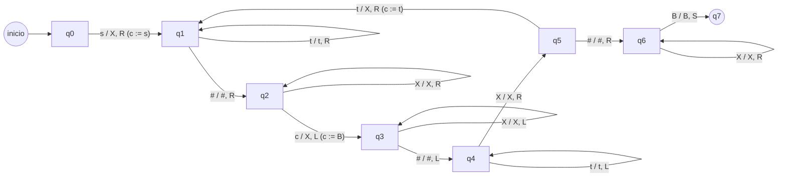
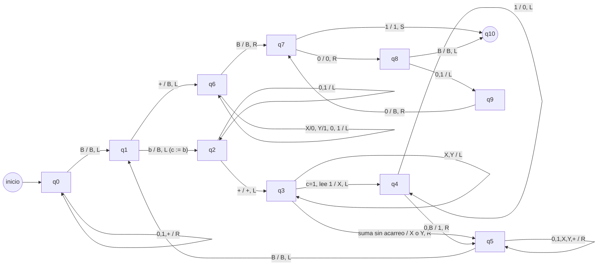
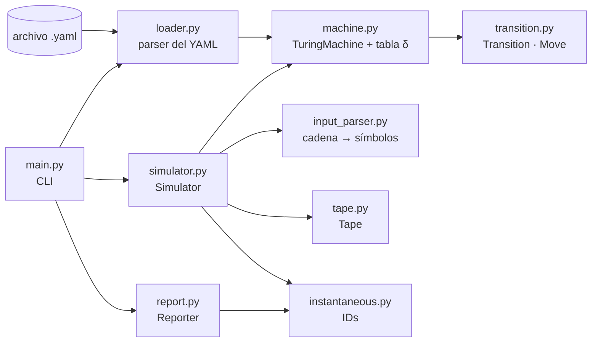

# Proyecto 3 — Simulador de Máquinas de Turing

Teoría de la Computación — Universidad del Valle de Guatemala

## Integrantes

| Nombre        | Carné |
|---------------|-------|
| Jorge Villeda | 24932 |
| Lázaro Díaz   | 24713 |

**Video de demostración:** _(pendiente: enlace de YouTube no listado)_

## Descripción

Simulador de Máquinas de Turing (MT) deterministas de **una cinta**, escrito en
Python. El programa:

1. Lee la descripción formal de la MT desde un archivo YAML (el formato del enunciado).
2. Valida la definición: estados, alfabetos, símbolos de cada transición y determinismo.
3. Parsea cada cadena de `simulation_strings` en símbolos del alfabeto de entrada y la coloca en la cinta.
4. Simula la MT aplicando la función de transición δ y muestra **todas las
   descripciones instantáneas (IDs)**, junto con la transición usada en cada paso.
5. Indica si la cadena es **aceptada** (la MT llegó a un estado final) o
   **rechazada** (la MT se detuvo sin poder aplicar una transición), y muestra
   el contenido final de la cinta.

Se incluyen dos máquinas:

| Archivo | Tipo | Qué hace |
|---|---|---|
| [`maquinas/reconocedora_wcw.yaml`](maquinas/reconocedora_wcw.yaml) | Reconocedora | Acepta `L = { w#w \| w ∈ {a, b, c}+ }` |
| [`maquinas/alteradora_suma_binaria.yaml`](maquinas/alteradora_suma_binaria.yaml) | Alteradora | Transforma `x+y` (binarios) en su suma, p. ej. `1011+110 → 10001` |

## Requisitos e instalación

- Python 3.8 o superior
- PyYAML

```bash
pip install -r requirements.txt
```

## Uso

```bash
# Simular las cadenas de simulation_strings de cada máquina
python main.py maquinas/reconocedora_wcw.yaml
python main.py maquinas/alteradora_suma_binaria.yaml

# Varias máquinas a la vez
python main.py maquinas/reconocedora_wcw.yaml maquinas/alteradora_suma_binaria.yaml

# Simular otras cadenas (en lugar de las del archivo)
python main.py maquinas/alteradora_suma_binaria.yaml --cadena 110010+10111 --cadena 1+1

# Solo la tabla de resultados, sin IDs
python main.py maquinas/reconocedora_wcw.yaml --solo-resumen

# Guardar la salida en un archivo de texto
python main.py maquinas/reconocedora_wcw.yaml --salida salidas/wcw.txt
```

| Opción | Descripción |
|---|---|
| `-c`, `--cadena CADENA` | Simula esta cadena en lugar de `simulation_strings` (se puede repetir; `''` es la cadena vacía) |
| `-m`, `--max-pasos N` | Límite de pasos por cadena (por defecto 10 000) para detectar MTs que no se detienen |
| `--solo-resumen` | No imprime las IDs, solo la tabla final |
| `--sin-transiciones` | Oculta la transición aplicada junto a cada ID |
| `--sin-color` | Desactiva los colores (también se desactivan solos si la salida no es una terminal o existe `NO_COLOR`) |
| `-o`, `--salida ARCHIVO` | Guarda también la salida, sin colores, en un archivo |

### Ejemplo de salida

```text
 Cadena 1/1: 11+1
───────────────────────────────────────────────
     0   [q0, B] 11+1
  ⊢  1   1 [q0, B] 1+1    δ([q0, B], 1) = ([q0, B], 1, R)
  ...
  ⊢  6   11 [q2, 1] +     δ([q1, B], 1) = ([q2, 1], B, L)
  ⊢  7   1 [q3, 1] 1+     δ([q2, 1], +) = ([q3, 1], +, L)
  ⊢  8   [q4, B] 1X+      δ([q3, 1], 1) = ([q4, B], X, L)
  ...
  ⊢ 19   [q7, B] 100      δ([q6, B], B) = ([q7, B], B, R)
  ⊢ 20   [q10, B] 100     δ([q7, B], 1) = ([q10, B], 1, S)

 Resultado: ACEPTADA
   la MT se detuvo en el estado de aceptación q10 después de 20 pasos
 Cinta final: 100
```

Cada ID tiene la forma **`α [q, c] β`**: `α` es lo que está a la izquierda
del cabezal, `[q, c]` es el estado (estado de control `q` + valor de la caché
`c`) y el cabezal está sobre el **primer símbolo de `β`**. `B` es el blank.
Como en clase, se omiten los blanks de los extremos salvo el que está bajo el
cabezal.

## Formato del archivo YAML

```yaml
q_states:
  q_list: [q0, q1, q2]       # Q
  initial: q0                # estado inicial
  final: q2                  # estado final (también acepta una lista)
alphabet:                    # Σ (alfabeto de entrada)
- a
- "#"                        # '#' debe ir entre comillas: en YAML inicia un comentario
tape_alphabet:               # Γ (incluye a Σ)
- a
- "#"
- X
-                            # entrada vacía = blank
delta:
- params:
    initial_state: q0
    mem_cache_value:         # vacío = blank
    tape_input: a
  output:
    final_state: q1
    mem_cache_value: a       # guarda 'a' en la caché
    tape_output: X
    tape_displacement: R     # L, R o S
simulation_strings:
- aa#aa
```

Detalles de la interpretación:

- **Estado con caché.** Cada estado es un par `[q, c]`. La transición de arriba
  es `δ([q0, B], a) = ([q1, a], X, R)`. La caché inicia en blank.
- **Blank.** Una entrada vacía, `null`, `~` o `None` es el blank. En las IDs se
  muestra como `B` (o `□` si `B` ya es un símbolo de Γ).
- **Todo se lee como texto.** El YAML se carga con `yaml.BaseLoader`, así que
  `0`, `01` o `yes` no se convierten en número ni en booleano. Esto importa para
  estados como `'0'` y para cadenas binarias como `0101`, que con `safe_load`
  se convertirían en el octal 65.
- **Σ ⊆ Γ.** Si a `tape_alphabet` le falta algún símbolo de `alphabet`, se
  agrega y se muestra una advertencia (el ejemplo del enunciado no lista `a` y `b`).
- **Cadenas de entrada.** Se parten en símbolos de Σ. Si un símbolo no
  pertenece a Σ, la cadena se rechaza sin simular. Para usar símbolos de varios
  caracteres hay que separarlos con espacios (`q1 q2 #`).
- **Llaves opcionales.** `name` y `description` se muestran en el encabezado.

Errores que se detectan al cargar: llaves faltantes, YAML mal formado, estados
que no están en `q_list`, símbolos fuera de Γ, desplazamientos distintos de
`L/R/S` y transiciones en conflicto (MT no determinista). Cada mensaje indica
qué transición (`delta[n]`) tiene el problema.

---

## MT 1 — Reconocedora: `L = { w#w | w ∈ {a, b, c}+ }`

Acepta una palabra no vacía sobre `{a, b, c}`, seguida de `#` y de una copia
exacta de esa palabra. `L` **no es libre de contexto**, así que ningún
autómata de pila puede reconocerlo. Hace falta la MT.

**Definición formal**

- Q = {q0, q1, q2, q3, q4, q5, q6, q7}, con la caché c ∈ {B, a, b, c}
- Σ = {a, b, c, #}
- Γ = {a, b, c, #, X, B}
- Estado inicial: [q0, B] · Estados finales: F = {q7}
- δ: 33 transiciones

**Idea.** La caché "carga" cada símbolo de la izquierda hasta su pareja a la derecha del `#`:

1. Toma el primer símbolo `s` no marcado de `w`, lo marca con `X` y lo guarda en la caché: `[q1, s]`.
2. Avanza hasta `#`, salta las `X` de la derecha y compara el primer símbolo no
   marcado con la caché. Si coincide, lo marca con `X`. Si no coincide, **no hay
   transición** y la cadena se rechaza.
3. Regresa a la izquierda hasta la última `X` de `w` y repite.
4. Cuando a la izquierda ya no quedan símbolos (lee `#`), verifica que a la
   derecha solo haya `X` y acepta.

**Función de transición** (s, t ∈ {a, b, c}; cada fila con s o t equivale a 3 transiciones del YAML)

| Estado | Lee | Nuevo estado | Escribe | Mueve | Propósito |
|---|---|---|---|---|---|
| [q0, B] | s | [q1, s] | X | R | marca el primer símbolo de w y lo guarda en caché |
| [q1, s] | t | [q1, s] | t | R | avanza hasta `#` |
| [q1, s] | # | [q2, s] | # | R | cruza el separador |
| [q2, s] | X | [q2, s] | X | R | salta lo ya emparejado |
| [q2, s] | s | [q3, B] | X | L | coincide con la caché: marca y regresa |
| [q3, B] | X | [q3, B] | X | L | regresa sobre las X de la derecha |
| [q3, B] | # | [q4, B] | # | L | cruza el separador |
| [q4, B] | t | [q4, B] | t | L | regresa sobre lo no marcado de w |
| [q4, B] | X | [q5, B] | X | R | encontró la última X de w |
| [q5, B] | t | [q1, t] | X | R | toma el siguiente símbolo de w |
| [q5, B] | # | [q6, B] | # | R | w ya se recorrió completa |
| [q6, B] | X | [q6, B] | X | R | a la derecha solo debe haber X |
| [q6, B] | B | [q7, B] | B | S | **acepta** |



> Etiquetas: `lee / escribe, mueve`. En q2 → q3, `c / X` significa "lee el
> mismo símbolo que está guardado en la caché". `(c := s)` indica qué se guarda
> en la caché.

**Cadenas de prueba** (todas con longitud ≥ 5)

| Cadena | Resultado | Pasos | Motivo |
|---|---|---|---|
| `abc#abc` | ACEPTADA | 32 | |
| `bacab#bacab` | ACEPTADA | 72 | |
| `ccab#ccab` | ACEPTADA | 50 | |
| `abc#acb` | RECHAZADA | 13 | la copia no coincide: no existe δ([q2, b], c) |
| `abca#abc` | RECHAZADA | 38 | a la derecha falta un símbolo: no existe δ([q2, a], B) |
| `ab#abca` | RECHAZADA | 17 | a la derecha sobra un símbolo: no existe δ([q6, B], c) |

---

## MT 2 — Alteradora: suma binaria `x+y → x + y`

Recibe dos números binarios separados por `+` y deja en la cinta **solo su
suma**, sin ceros a la izquierda. Si x está vacío cuenta como 0 (`+101 → 101`).
Si la entrada no tiene exactamente un `+`, se rechaza.

**Definición formal**

- Q = {q0, …, q10}, con la caché c ∈ {B, 0, 1} (el bit que se está sumando)
- Σ = {0, 1, +}
- Γ = {0, 1, +, X, Y, B}. `X` y `Y` marcan los bits del resultado ya calculados (`X` = 0, `Y` = 1).
- Estado inicial: [q0, B] · Estados finales: F = {q10}
- δ: 43 transiciones

**Idea.** Suma bit a bit, del menos al más significativo, igual que a mano:

1. Va al final, toma el último bit de `y`, lo **borra** y lo guarda en la caché.
2. Lo lleva a la izquierda hasta `x`, salta los bits ya procesados (`X`/`Y`) y
   lo suma al primer bit no procesado de `x`. Un blank cuenta como 0, así que `x`
   puede ser más corto que `y`.
3. Si la suma da 2, escribe `X` y **propaga el acarreo** a la izquierda: cambia
   1 → 0 hasta encontrar un 0 o un blank, que se vuelve 1.
4. Cuando `y` se queda sin bits (lo último que queda es `+`), borra el `+`,
   cambia `X → 0` y `Y → 1`, y **elimina los ceros a la izquierda**. Si el
   resultado es 0, conserva un `0`.

**Función de transición** (b ∈ {0, 1}; z ∈ {X, Y})

| Estado | Lee | Nuevo estado | Escribe | Mueve | Propósito |
|---|---|---|---|---|---|
| [q0, B] | 0, 1, + | [q0, B] | (igual) | R | ir al final de la entrada |
| [q0, B] | B | [q1, B] | B | L | |
| [q1, B] | b | [q2, b] | B | L | toma y borra el último bit de y |
| [q1, B] | + | [q6, B] | B | L | y ya no tiene bits: borra `+` |
| [q2, b] | 0, 1 | [q2, b] | (igual) | L | lleva el bit hasta `+` |
| [q2, b] | + | [q3, b] | + | L | |
| [q3, b] | z | [q3, b] | z | L | salta bits ya procesados |
| [q3, 0] | 0 / B | [q5, B] | X | R | 0 + 0 = 0 |
| [q3, 0] | 1 | [q5, B] | Y | R | 1 + 0 = 1 |
| [q3, 1] | 0 / B | [q5, B] | Y | R | 0 + 1 = 1 |
| [q3, 1] | 1 | [q4, B] | X | L | 1 + 1 = 10: escribe 0 y lleva 1 |
| [q4, B] | 1 | [q4, B] | 0 | L | el acarreo sigue |
| [q4, B] | 0 / B | [q5, B] | 1 | R | el acarreo termina |
| [q5, B] | 0, 1, X, Y, + | [q5, B] | (igual) | R | regresa al final |
| [q5, B] | B | [q1, B] | B | L | siguiente bit de y |
| [q6, B] | X / Y | [q6, B] | 0 / 1 | L | limpia las marcas |
| [q6, B] | 0, 1 | [q6, B] | (igual) | L | |
| [q6, B] | B | [q7, B] | B | R | inicio del resultado |
| [q7, B] | 1 | [q10, B] | 1 | S | **acepta**: sin ceros a la izquierda |
| [q7, B] | 0 | [q8, B] | 0 | R | ¿es el último dígito? |
| [q8, B] | B | [q10, B] | B | L | **acepta**: el resultado es 0 |
| [q8, B] | 0, 1 | [q9, B] | (igual) | L | era un cero a la izquierda |
| [q9, B] | 0 | [q7, B] | B | R | lo borra |



**Cadenas de prueba** (todas con longitud ≥ 5)

| Cadena | Operación | Cinta final | Pasos |
|---|---|---|---|
| `1011+110` | 11 + 6 = 17 | `10001` | 50 |
| `111+111` | 7 + 7 = 14 | `1110` | 48 |
| `1111+1` | 15 + 1 = 16 (el acarreo extiende x) | `10000` | 28 |
| `101+1101` | 5 + 13 = 18 (y más largo que x) | `10010` | 67 |
| `0010+0011` | 2 + 3 = 5 (quita ceros a la izquierda) | `101` | 66 |

---

## Arquitectura



| Módulo | Responsabilidad |
|---|---|
| [`turing/symbols.py`](turing/symbols.py) | Representación del blank (`None`) y normalización de símbolos leídos del YAML |
| [`turing/transition.py`](turing/transition.py) | `Move` (L/R/S) y la transición `δ([q, c], a) = ([p, d], b, M)` como `TransitionParams` → `TransitionOutput` |
| [`turing/machine.py`](turing/machine.py) | `TuringMachine` = (Q, Σ, Γ, δ, q0, B, F). Valida la definición y guarda δ en un diccionario |
| [`turing/loader.py`](turing/loader.py) | **Parsing de la configuración**: YAML → `TuringMachine` + cadenas a simular |
| [`turing/input_parser.py`](turing/input_parser.py) | **Parsing de la entrada en la cinta**: cadena → lista de símbolos de Σ |
| [`turing/tape.py`](turing/tape.py) | Cinta infinita en ambos sentidos con un cabezal |
| [`turing/instantaneous.py`](turing/instantaneous.py) | Descripción instantánea `α [q, c] β` |
| [`turing/simulator.py`](turing/simulator.py) | `Configuration` (estado + caché + cinta), `step()` y `run()` con el veredicto |
| [`turing/report.py`](turing/report.py) | Texto de salida: encabezado, IDs, resultado y tabla resumen (con o sin color) |
| [`main.py`](main.py) | Interfaz de línea de comandos |

### Estructuras de datos

- **Función de transición: diccionario.** La llave es `TransitionParams(state, cache, read)`,
  una dataclass inmutable y *hashable*, y el valor es la `Transition`. En cada
  paso, encontrar la regla a aplicar es una sola búsqueda en O(1). Al construir
  la tabla, si dos reglas tienen la misma llave y distinta salida, la MT no es
  determinista y se reporta el error.
- **Cinta: diccionario `posición → símbolo`.** Solo guarda las celdas que no son
  blank. Puede crecer a la izquierda (posiciones negativas) y a la derecha sin
  desplazar listas, y una celda que nunca se escribió vale blank. Escribir un
  blank borra la entrada.
- **Estado con caché.** El estado actual es el par `(state, cache)` dentro de
  `Configuration`. La caché es simplemente un símbolo más de la configuración, y
  δ la consulta y la actualiza como parte del estado. Así se implementa la
  técnica de "almacenamiento en el estado finito" vista en clase.
- **IDs inmutables.** En cada paso se toma una "foto" (`InstantaneousDescription`)
  con la parte visible de la cinta, el estado, la caché y la transición aplicada.
  El resultado (`SimulationResult`) guarda la lista completa.

### Algoritmo de simulación

```text
config ← [q0, B], cinta = entrada, cabezal en la posición 0
IDs ← [ID(config)]
repetir:
    si config.q ∈ F            → ACEPTADA (la MT se detiene al aceptar)
    si pasos ≥ límite          → RECHAZADA por límite de pasos
    t ← δ([q, c], cinta[cabezal])
    si t no existe             → RECHAZADA (se detuvo en un estado no final)
    escribir, mover, cambiar a [p, d]
    IDs.append(ID(config, t))
```

### Decisiones de diseño

- La MT **se detiene al entrar a un estado final**. Por eso las transiciones que
  salen de un estado final nunca se usan, y el cargador lo advierte.
- El **límite de pasos** (configurable con `--max-pasos`) evita que el programa
  se cuelgue con una MT que no se detiene. Ese caso se reporta aparte.
- Una cadena con símbolos fuera de Σ **no se simula**: se rechaza con un
  mensaje que indica el símbolo y su posición.
- La lógica (paquete `turing`) no imprime nada. `report.py` y `main.py` se
  encargan de la presentación, por eso el simulador se puede probar sin consola.

## Pruebas

```bash
python -m unittest -v
```

Hay 65 pruebas. Además de las pruebas unitarias de cada módulo, las dos
máquinas se verifican **exhaustivamente** contra una implementación de
referencia en Python:

- **w#w:** las 5 461 cadenas sobre `{a, b, c, #}` de longitud ≤ 6.
- **Suma binaria:** las 3 280 cadenas sobre `{0, 1, +}` de longitud ≤ 7
  (incluye las entradas mal formadas) y 50 sumas aleatorias de números de hasta 12 bits.

## Estructura del repositorio

```text
.
├── main.py                         # CLI
├── requirements.txt
├── maquinas/
│   ├── reconocedora_wcw.yaml       # MT 1: w#w
│   └── alteradora_suma_binaria.yaml# MT 2: suma binaria
├── turing/                         # simulador
│   ├── symbols.py
│   ├── errors.py
│   ├── transition.py
│   ├── tape.py
│   ├── machine.py
│   ├── loader.py
│   ├── input_parser.py
│   ├── instantaneous.py
│   ├── simulator.py
│   └── report.py
└── tests/
    ├── fixtures/ejemplo_enunciado.yaml
    └── test_*.py
```

## Guion sugerido para el video

1. **Arquitectura.** Recorrer el diagrama de módulos y explicar las estructuras
   de datos (δ como diccionario, cinta como diccionario, estado con caché).
2. **MT reconocedora:**
   `python main.py maquinas/reconocedora_wcw.yaml --cadena abc#abc --cadena ccab#ccab --cadena abc#acb --cadena abca#abc`
   Son 2 cadenas aceptadas y 2 rechazadas.
3. **MT alteradora:**
   `python main.py maquinas/alteradora_suma_binaria.yaml --cadena 1011+110 --cadena 111+111 --cadena 1111+1 --cadena 101+1101`
   Son 4 cadenas, todas con longitud ≥ 5.
